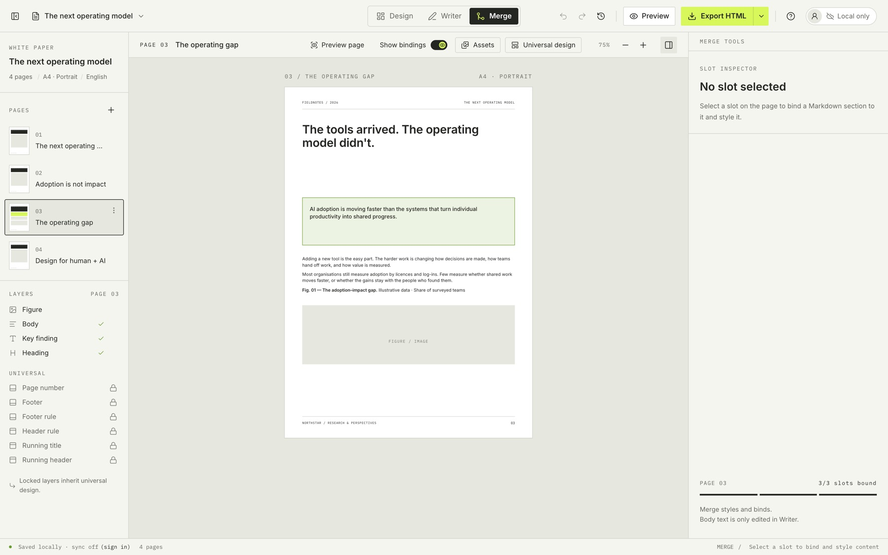
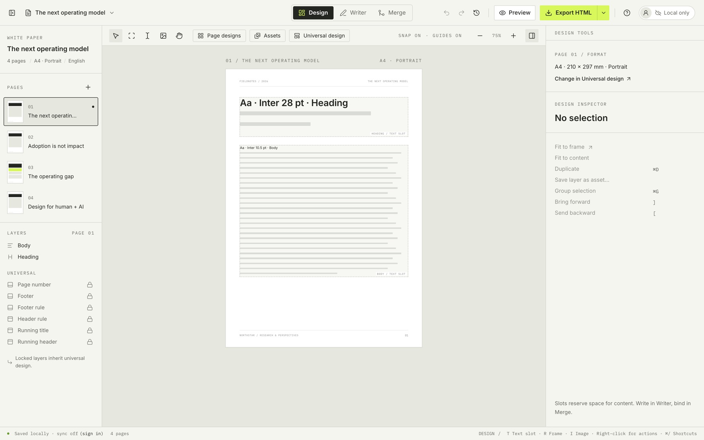
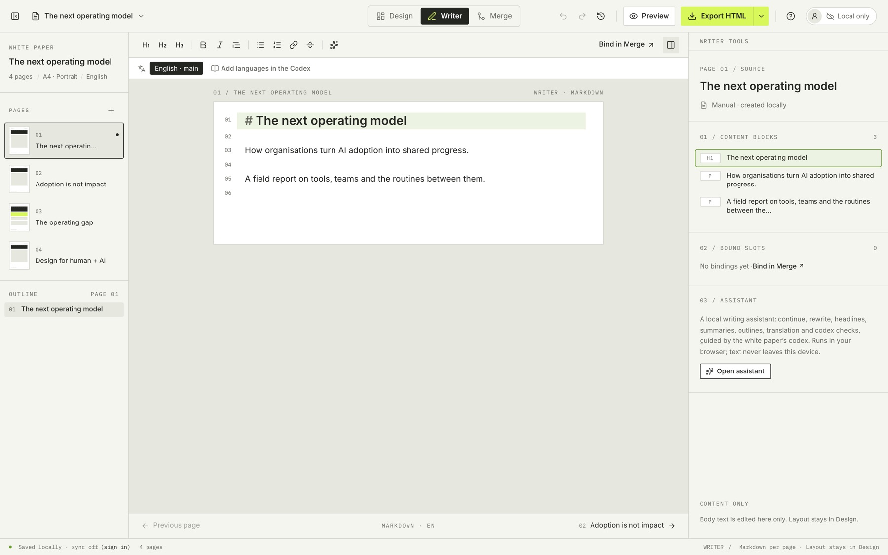

<p align="center">
  <a href="https://pengrid.app"></a>
</p>

<h1 align="center">Pengrid</h1>

<p align="center">
  <strong>Write the words. Design the page. Merge them.</strong><br>
  The desktop app for papers, essays, white papers and reports that have to read well <em>and</em> look good.
</p>

<p align="center">
  <a href="../../releases/latest"></a>
  &nbsp;
  <a href="https://pengrid.app"></a>
</p>

<p align="center">
  
  
  
  
</p>

<p align="center">
  
</p>

---

## Your text and your layout, finally apart

Most long documents die in the design tool. The text goes into boxes too early, every edit moves something, and by the third review round nobody dares to change a sentence.

Pengrid keeps the words and the page separate until you bind them. Rewrite without breaking the design. Redesign without touching a sentence.

| | |
| --- | --- |
| **✍️ Writer** | A calm Markdown editor with nothing but the words: outline, numbered content blocks, translations side by side. |
| **📐 Design** | Lay out pages on a grid like in Figma: text slots, frames and images, snapping, guides, and running headers that run themselves. |
| **🔗 Merge** | Pick a slot, tick the blocks that belong in it, and watch the page fill in. Preview shows exactly what you'll export. |

<p align="center">
  
  
</p>

## Made for every document that has to look good

`Papers` · `Essays` · `White papers` · `Reports` · `Research papers` · `E-books` · `Guides` · `Case studies` · `Proposals` · `Brochures` · `Newsletters` · `Annual reports`

- **PDF import.** Drop in last year's PDF: the text lands in Writer, the layout in Design, and the charts, logos, colours and fonts in your asset library.
- **One design, every language.** Translate a page or the whole document; Pengrid flags what's out of date and exports one file per language.
- **An assistant on your own computer.** Continue, tighten, rewrite, summarise and translate, following your brief on audience and tone. Your drafts are never sent to a server.
- **Brand kit.** Your typefaces, named colours, reusable layers and page designs, everywhere.
- **Export.** A self-contained HTML file with your fonts embedded, or a print-ready PDF.
- **Teams when you want them.** Sign in to keep papers in your organisation's cloud, invite colleagues, and decide per paper who edits and who reads.

## Yours, offline, no account needed

Pengrid is a complete desktop app on its own. Unreleased research, pricing and roadmaps stay on your machine. An account is optional and only adds cloud papers and sharing. You can always export a paper to a file.

## Install

### Download

Get the [latest release](../../releases/latest) and pick the dmg for your Mac:

| Your Mac | File |
| --- | --- |
| Apple silicon (M1 and later) | `Pengrid-<version>-arm64.dmg` |
| Intel | `Pengrid-<version>-x64.dmg` |

Open the dmg and drag Pengrid to Applications. Every build is signed with a Developer ID and notarised by Apple, so it opens without a Gatekeeper warning. Pengrid needs macOS 13 Ventura or later. Windows and Linux are coming.

### Homebrew

```sh
brew tap pengrid-app/pengrid-releases https://github.com/pengrid-app/pengrid-releases
brew trust pengrid-app/pengrid-releases
brew install --cask pengrid
```

## Pricing

Pengrid is free to use. Paid plans for professionals and teams are on the way; see [pengrid.app/#pricing](https://pengrid.app/#pricing).

## Support

Found a bug or missing a feature? [Open an issue](../../issues/new). For anything else, from questions to team plans, write to **[hello@pengrid.app](mailto:hello@pengrid.app)**.

---

<p align="center">
  <sub>This repository holds Pengrid's release files only. Made in Sweden · © 2026 Pengrid</sub>
</p>
